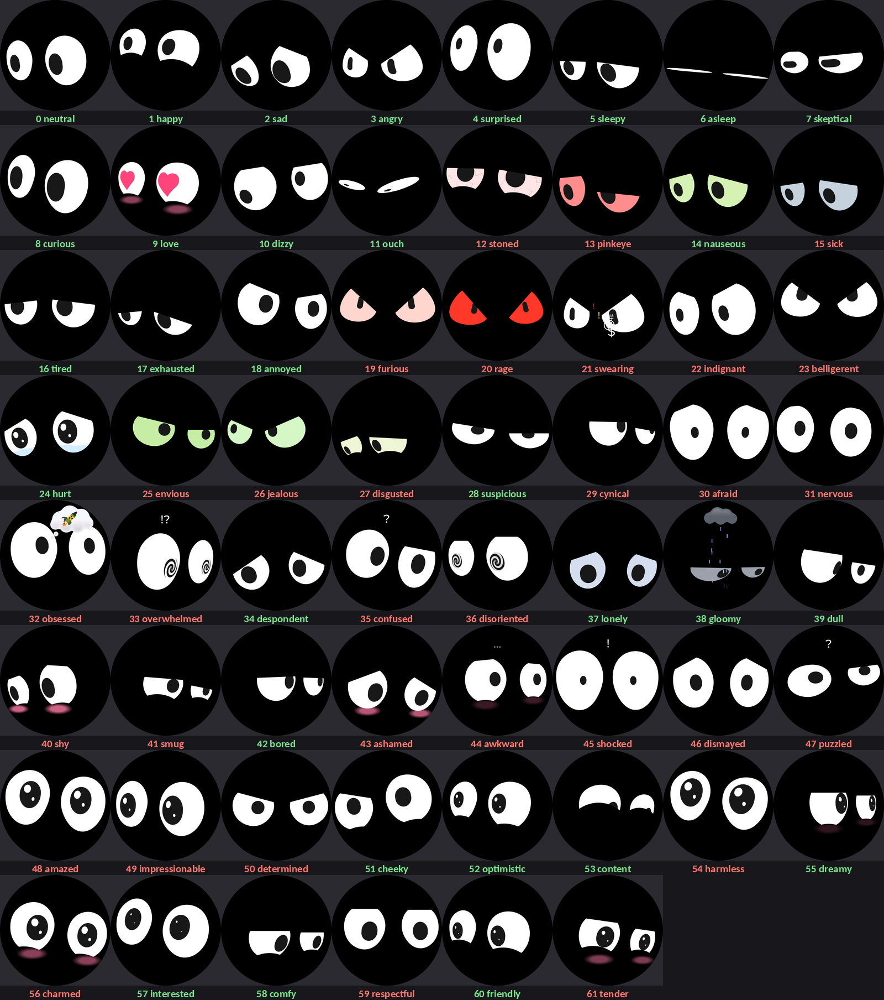
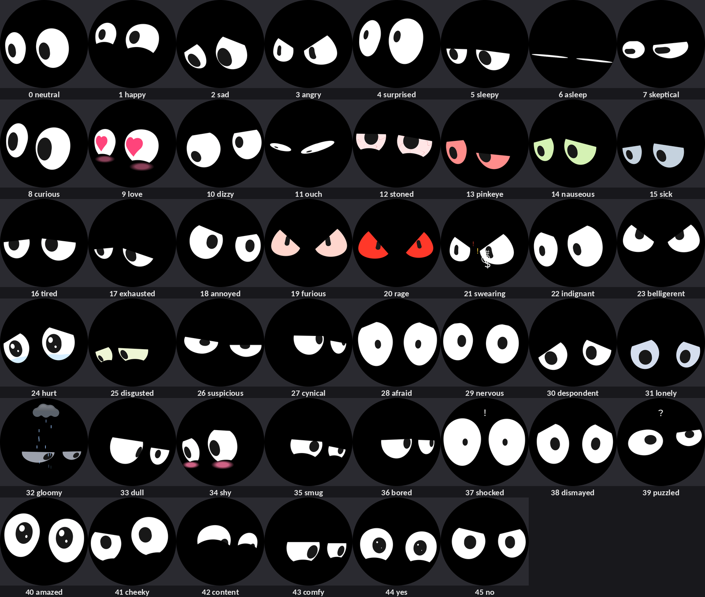
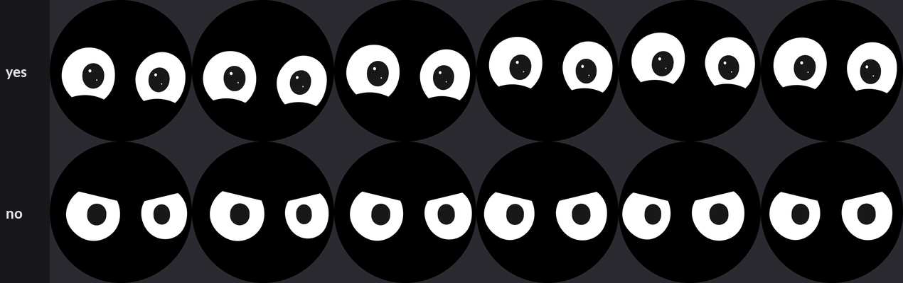
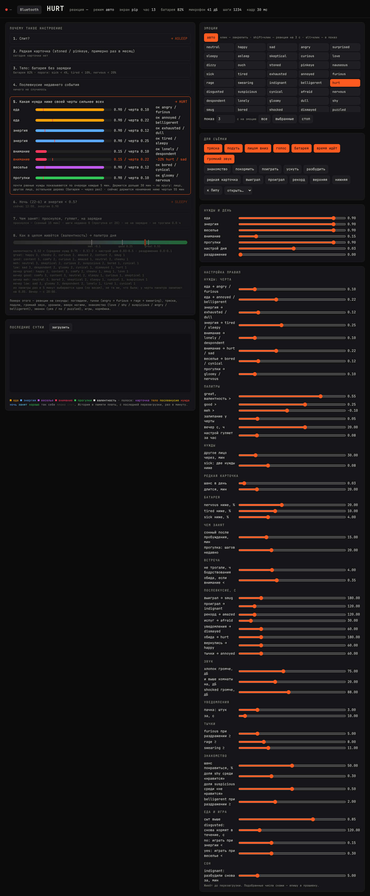

# Pip-KeyPet PT-BR + Muse Gadget 🤖

Projeto de integração do **Pip-KeyPet** com o **Muse Gadget SDK**, com foco em transformar o dispositivo em um **Tamagotchi virtual com IA**, mantendo o rosto expressivo e a personalidade do Pip.

A proposta combina a interface e o ciclo de vida do bichinho do Pip com a infraestrutura do Muse para firmware, tela, áudio, conectividade e interação com serviços de IA.

## Visão do projeto

- **Pip:** identidade visual, expressões, humor, necessidades, animações e comportamento de Tamagotchi.
- **Muse Gadget SDK:** base de firmware, integração com o hardware, interface LVGL, áudio e conectividade.
- **Objetivo:** um companheiro portátil com rosto animado, personalidade persistente e interação por voz com IA.

## Imagens de referência

As imagens abaixo vêm da documentação visual do projeto original Pip-KeyPet e servem como referência para preservar as expressões e a identidade do personagem durante a integração.

| Expressões do Pip | Reações do Pip |
|---|---|
|  |  |

| Sim e não | Painel de expressões |
|---|---|
|  |  |

Créditos das imagens: [NovikovVisuals/Pip-KeyPet](https://github.com/NovikovVisuals/Pip-KeyPet). Os arquivos foram adicionados como referências visuais, não como uma nova autoria do personagem.

## Hardware-alvo

**Waveshare ESP32-S3-Touch-AMOLED-1.75C**

O Muse SDK já possui suporte para esta família de placa. A integração será feita sobre a implementação de hardware do Muse, evitando inicializações duplicadas de tela, áudio, Bluetooth ou outros periféricos.

## Arquitetura planejada

1. O Muse inicializa e gerencia o hardware e os serviços do dispositivo.
2. O componente de personalidade do Pip mantém fome, energia, diversão, carinho, humor e reações.
3. A interface do Pip é adaptada para LVGL e passa a renderizar o rosto e suas animações na tela do Muse.
4. Os eventos de voz e IA alimentam a personalidade do Pip, que responde com expressões e comportamentos próprios.

## Estado atual

**Status: Em desenvolvimento**

- [x] Repositórios originais conectados como submódulos.
- [x] Estrutura inicial de integração criada.
- [x] Motor de personalidade do Pip integrado como componente C independente.
- [x] Testes automatizados do motor de personalidade e persistência.
- [x] Referências visuais do personagem adicionadas.
- [x] Adaptador inicial do renderizador de olhos do Pip para o avatar customizado do Muse (128 × 128).
- [ ] Integrar todas as animações e expressões do Pip ao LVGL.
- [ ] Integrar os eventos de voz e IA à personalidade.
- [ ] Resolver e validar a compatibilidade entre as versões do ESP-IDF.
- [x] Testes automatizados do motor de personalidade no GitHub Actions.
- [ ] Compilar o firmware completo Muse + Pip.
- [ ] Validar o firmware no hardware.

Para preparar o checkout local do firmware Muse com o avatar do Pip, execute `sh firmware/scripts/apply_muse_overlay.sh` na raiz do repositório após inicializar os submódulos.

**Importante:** esta branch é uma base de desenvolvimento. O firmware integrado ainda não foi compilado nem validado em dispositivo e não deve ser gravado como se fosse uma versão pronta.

## Repositórios de origem

- [Pip-KeyPet](https://github.com/NovikovVisuals/Pip-KeyPet)
- [Muse Gadget SDK](https://github.com/facebookincubator/muse-gadget-sdk)

O código original é mantido nos respectivos repositórios e referenciado neste projeto por submódulos, com commits fixados para tornar a integração reproduzível.

## Interface web em português

A versão traduzida do painel web continua disponível em:

**[Abrir Pip-KeyPet PT-BR](https://dutragusta.github.io/Pip-KeyPet-PTBR/)**

## Licenças e créditos

Este projeto integra componentes de terceiros. Consulte as licenças e avisos de cada repositório de origem antes de redistribuir binários ou versões derivadas. As imagens de referência permanecem creditadas ao projeto original Pip-KeyPet.
